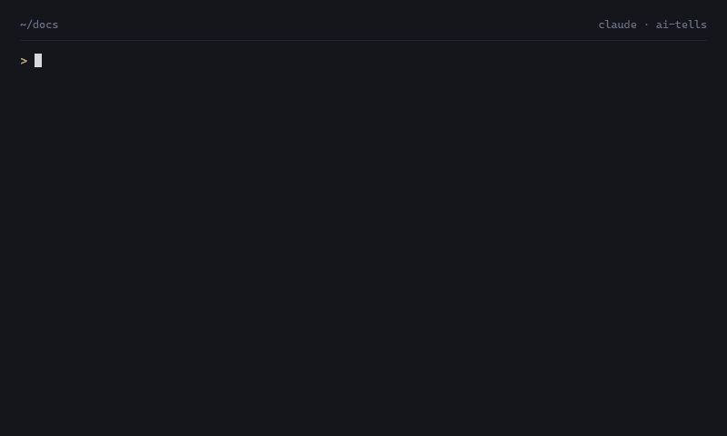

<!-- slop-lint-disable-file: rule table quotes the tells -->

# ai-tells



A Claude Code plugin that helps agents write prose and build UIs that don't read as AI-generated.

AI output tends toward the statistically safest choice: puffed-up significance, "delve" and "tapestry", em dashes everywhere, purple gradient headlines, eyebrow labels, identical card grids. Each choice is fine alone. Together they look like nobody decided anything. This plugin gives the agent rules to follow before it writes, and a linter that checks the result afterward.

## What's in it

| Piece | What it does |
|---|---|
| `skills/human-writing` | Writing rules: hard fails (chatbot leakage, placeholders), strong tells (puffery, "-ing" tails, "not X but Y", vague attribution, AI vocabulary), formatting tells, and a "don't overcorrect" section. |
| `skills/human-ui` | UI rules: gradient text, purple/neon palettes, aurora glow, eyebrows, italic serif heroes, cards in cards, rainbow side tabs, status dots, emoji icons, decorative numbering, missing real images, fake social proof. |
| `skills/human-code` | Code habits: narrating comments, "// Step N", brace labels, hype comments, placeholder stubs, emoji logs, blanket catches, generic names, single-use abstractions, mock-only tests. |
| `agents/slop-reviewer` | Read-only reviewer. Runs the linter, reads the files, and returns a verdict with rewrites. |
| `commands/deslop` | `/deslop <path> [--review-only]` finds and fixes tells. It doesn't make up facts; where real content is missing it leaves a TODO. |
| `commands/slop-review` | `/slop-review [path]` reviews a repo, folder or file without changing anything. It runs the linter for an overview, then hands the worst files to the read-only `slop-reviewer` agent, which has no Edit or Write tools. |
| `scripts/slop-lint.mjs` | Node linter with no dependencies. Checks Markdown/text prose, HTML/JSX/TSX/Vue/Svelte/Astro (text nodes and Tailwind classes), and CSS. |
| `hooks/hooks.json` | PostToolUse hook. After each Write/Edit, findings at `med` severity or higher go back to the agent as context. For an Edit, it only reports the lines that changed. It skips `.txt`/`.rst` files and files over 300 KB, and it never blocks a write. |

## Install

In Claude Code:

```
/plugin marketplace add zacharyinserra/ai-tells
/plugin install ai-tells@ai-tells
```

To work on a local clone instead, point the marketplace at the folder:

```
/plugin marketplace add ./ai-tells
```

You can also run the linter by itself:

```bash
node scripts/slop-lint.mjs docs/ src/components --min=med
node scripts/slop-lint.mjs page.tsx --json
```

The exit code is 0 when it finds nothing, 1 when it finds something, and 2 on bad usage, so you can use it in CI.

## Configuration

| Env var | Effect |
|---|---|
| `AI_TELLS_HOOK=0` | Turns off the post-write hook. |
| `AI_TELLS_HOOK_MIN=low\|med\|high` | Sets the lowest severity the hook reports. The default is `med`. |

Suppress findings in a file with comments:

- `slop-lint-disable-file` anywhere in the file
- `slop-lint-disable-line` on the line itself
- `slop-lint-disable-next-line` on the line above

## Rules

Markdown code (fenced, indented, and inline), front matter, blockquotes and URLs aren't treated as prose.

Prose: `chatbot-leakage`, `chat-phrasing` (low, or med when it's in the last few lines as a sign-off), `generation-artifact`, `puffery`, `participle-tail`, `negative-parallelism`, `vague-attribution`, `formulaic-closer`, `hedging-disclaimer`, `stock-opener`, `staged-runup`, `dramatic-closer`, `straw-man`, `deep-saying`, `stacked-qualifier`, `meta-writing`, `theater-dismissal`, `placeholder-name`, `connective-filler`, `repeated-openings`, `section-dividers`, `ai-vocab`, `ai-vocab-density`, `em-dash-density`, `uniform-rhythm`, `subject-first-monotony`, `triplet-lists`, `uniform-paragraphs`, `restated-heading`, `closing-question`, `title-case-headings`, `inline-header-list`, `bold-overuse`, `emoji-bullet`, `curly-quotes`.

UI: `gradient-text`, `purple-gradient`, `neon-palette`, `glow-blob`, `neon-glow`, `eyebrow-label`, `serif-hero-font`, `side-tab-accent`, `status-dot`, `identical-cards`, `emoji-ui`, `em-dash-label`, `decorative-numbering`, `unsourced-stats`, `fake-testimonials`, `markdown-bleed`, `overused-font`, `glassmorphism`, `hard-offset-shadow`, `decorative-texture`, `decorative-grid`, `extreme-radius`, `bounce-easing`, `marquee`, `blinking-cursor`, `scroll-reveal-everywhere`, `magic-z-index`, `width-100vw`, `mixed-icon-sets`, `badge-above-headline`, `icon-tile-cards`, `ghost-card`, `centered-fullscreen-hero`, `monotonous-spacing`, `fake-browser-chrome`, `generic-alt`, `colored-headline-word`, `stacked-slogans`, `typed-caps`, `flat-type-scale`, `token-bypass`.

Code (JS/TS/JSX/TSX/Python): `closing-brace-label`, `step-comments`, `hype-comment`, `placeholder-stub`, `emoji-logs`, `swallowed-error`.

These are heuristics. "Landscape" can mean terrain, and a status dot can show real status. The skills and the reviewer agent tell the model to treat a finding as a reason to look, and to ignore false positives. The goal is more specific, deliberate work. Fooling a detector isn't the point.

A lot of what readers actually notice is shape rather than wording: every list three items long, paragraphs all the same size, a first sentence that repeats the heading, a closing question nobody needed, sentence after sentence opening "It…". Those are counts, so the linter checks them too (`triplet-lists`, `uniform-paragraphs`, `restated-heading`, `closing-question`, `subject-first-monotony`). They're tuned against a few hundred pre-AI npm READMEs, where they fire on roughly 2% of files, all at `low` except the most blatant cases.

Some tells can't be linted at all: padding, claims with no facts behind them, prose that reports conclusions without any of the thinking, missing real images. The skills and the reviewer agent cover those.

## Sources

- [Wikipedia: Signs of AI writing](https://en.wikipedia.org/wiki/Wikipedia:Signs_of_AI_writing): vocabulary eras, puffery, copula avoidance, negative parallelism, chatbot leakage, placeholders, citation artifacts, formatting tells, and the overcorrection warning.
- [TeneX Studio: AI slop, 8 signs](https://tenex.studio/en/blog/ai-slop-8-signs/): em dashes, eyebrows, gradient headlines, italic serif heroes, missing images, decorative numbering, identical cards, fake numbers and names.
- [Fountain Institute: 7 tells a UI is AI-generated](https://pages.thefountaininstitute.com/posts/7-tells-that-a-ui-is-ai-generated): neon palettes, aurora glow, emoji, purple gradients, nested cards, rainbow side tabs, status dots.
- [Impeccable: slop catalog](https://impeccable.style/slop/): 68 detector and review rules: ghost cards, glassmorphism, icon tiles, monotonous spacing, bounce easing, marquees, overused fonts, and more.
- [Hallmark](https://github.com/Nutlope/hallmark) ([catalogue summary](https://instagit.com/Nutlope/hallmark/hallmark-anti-patterns-detected/)): centered full-screen hero, fake browser chrome, mixed icon sets, z-index 9999, placeholder names.
- [Utsubo: 12 "built with AI" signals](https://www.utsubo.com/blog/built-with-ai-trust-signals-2026): stock openers, hedging copy, generic alt text and meta.
- [Adrian Krebs: scoring Show HN pages for design slop](https://adriankrebs.ch/blog/design-slop/): about 1,600 pages scored with deterministic DOM/CSS checks; badge above the H1, Inter everywhere, colored card borders.
- [blader/humanizer](https://github.com/blader/humanizer): 26 writing patterns: staged run-ups, arguing with no one, sayings that sound deep, meta-writing, repeated openings, plus guardrails on what to leave alone.
- [aismells](https://aismells.pages.dev/ai-writing-tells.html): tour-guide voice, connective filler, emphasis overuse, Markdown in plain-text contexts.
- Code: [code-slop skill](https://claudeskills.info/skills/asyrafhussin/agent-skills/code-slop/), [why AI-generated code feels weird](https://dev.to/unknown_destroyer_f353870/why-ai-generated-code-feels-weird-1bd2), [what is slop and what's not](https://coops.is-a.dev/what-is-slop-and-whats-not/).
- *Not read:* [Medium: "I can tell your website was AI-generated"](https://medium.com/@TusharKanjariya/i-can-tell-your-website-was-ai-generated-0a6c73316db6). It's paywalled, so its specific tells aren't included yet.

Rules marked `[extra]` in the linter (seamless, elevate, unlock, and so on) are common marketing filler. None of the sources above list them.

## Tests

```bash
node test/run.mjs
```

## License

MIT. See [LICENSE](LICENSE).
